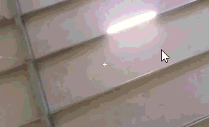
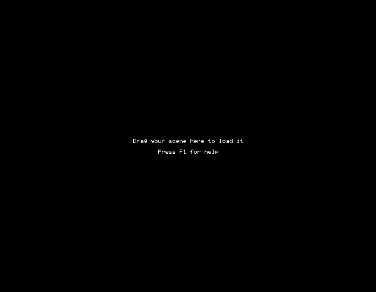
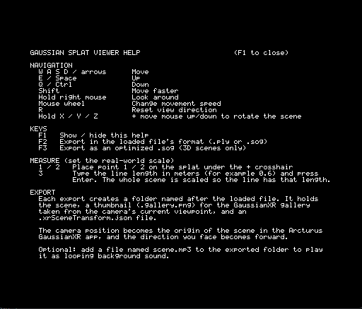

# GaussianXR Editor

This is a fork of
[abist-co-ltd/wgpu-gs-viewer](https://github.com/abist-co-ltd/wgpu-gs-viewer), a
Gaussian Splatting viewer written in Rust with wgpu. Refer to the upstream
repository for the original rendering design and documentation.

This fork was edited to make it very easy to prepare Gaussian splats that are
compliant with Arcturus GaussianXR for the Steam Frame: fly to the spot you want
as the origin, aim the camera, orient the scene, and export the scene together
with its gallery image.



*Rotating the scene with `X`/`Y`/`Z` and scaling it to a real-world size with
the measure tool (`1`, `2`, `3`).*

## Screenshots

### Viewing splats


### User interface

| Start screen | Help screen (`F1`) |
| --- | --- |
|  |  |

## Changes from upstream

- **First-person fly camera** replaces the orbit camera: move with
  `W`/`A`/`S`/`D`, look by holding the right mouse button.
- **Mouse capture**: the cursor is hidden and captured while the right mouse
  button is held, so it never hits the screen edge.
- **Adjustable movement speed** with the mouse wheel, plus a `Shift` speed
  boost.
- **No near clipping in practice**: the near plane is 0.0001 so splats can be
  viewed from very close.
- **Free scene rotation**: hold `X`, `Y` or `Z` and move the mouse up/down to
  rotate the scene smoothly around the camera's right, up or view axis, with the
  camera as the pivot (the cursor is captured). A 3x3 alignment grid is shown
  while a key is held.
- **Measure and scale tool**: place two points with `1` and `2` on the splat
  under a center crosshair (shown as a line with two dots so you can fly around
  and check the placement), then press `3` and type the real length in meters to
  scale the whole scene so the line has that length.
- **Color adjustment sidebar** (optional, opened with the `Adjust` button at the
  top right): Lightroom-style sliders for temperature, tint, exposure, contrast,
  highlights, shadows, saturation, vibrance and hue. The viewer shows the result
  live and the adjustments are baked into exported files. The same panel has
  `Rotate X/Y/Z` sliders (same axes as the `X`/`Y`/`Z` keys, with the alignment
  grid shown while dragging) and measurement buttons (`Place 1`, `Place 2`,
  `Enter measurement`, `Clear`).
- **Reset view** key to look straight ahead again.
- **Default orientation**: scenes are displayed rotated 180 degrees around Z to
  match the VR viewer's up axis. This is display-only and is not baked into
  exported files.
- **Export** of the loaded scene back to `.ply` or `.sog` (`F2` keeps the loaded
  file's format, `F3` always writes an optimized `.sog`):
  - the scene rotation is baked into the data (positions, orientations,
    spherical-harmonic colors, and 4D motion for STG-Lite PLY files),
  - the camera position becomes the origin (0, 0, 0) of the exported scene,
  - the scene is turned about the up axis only, so the camera's current heading
    becomes the forward direction (+Z, which is what Arcturus expects); pitch is
    not baked in,
  - the output is written to a `<name>/` folder together with a 512x512
    `<name>.gallery.png` screenshot of the current view and a
    `<name>.xrSceneTransform.json` (native build).
- **Camera starts at the origin** facing +Z, both at startup and whenever a file
  is loaded, so a re-loaded exported scene opens exactly where it was exported.
- **Export button** and updated help overlay in the web page (`index.html`).
- **Empty-state message**: "Drag your scene here to load it" is shown until a
  scene is loaded, and the window redraws immediately after a scene loads.
- **In-app help screen** toggled with `F1`: navigation, the `F1`/`F2`/`F3` keys,
  what an export contains (gallery thumbnail from the camera's viewpoint, camera
  position as the scene origin in Arcturus GaussianXR) and the optional
  `scene.mp3` background sound.
- New PLY writer, SOG v2 writer (lossless WebP images, quantized codebooks,
  clustered higher-order SH), and unit tests for the writers and SH rotation.

## How to use

Run the native viewer:

```sh
cargo run --release
```

Drag and drop a `.ply` (3DGS or Space-Time Gaussian Lite) or `.sog` (v2) file
onto the window to load it.

### Controls

| Input | Action |
| --- | --- |
| `W` / `A` / `S` / `D` (or arrow keys) | Move forward / left / backward / right |
| `E` / `Space` | Move up |
| `Q` / `Ctrl` | Move down |
| `Shift` | Move faster (4x) |
| Hold right mouse button + move mouse | Look around; the cursor is captured while held |
| Mouse wheel | Increase / decrease movement speed (15% per step) |
| `R` | Reset the view direction to the default heading (+Z) |
| Hold `X` / `Y` / `Z` + move mouse up/down | Rotate the scene smoothly around the camera's X (right), Y (up) or Z (view) axis, pivoting on the camera (0.3 degrees per pixel); a 3x3 alignment grid is shown and the cursor is captured while held |
| `1` / `2` | Place measurement point 1 / 2 on the splat under the center crosshair; a line and two dots are drawn between them |
| `3` | Open the length prompt: type the real length of the line in meters (for example `0.6`), `Enter` scales the scene so the line has that length, `Esc` cancels |
| `F1` | Show / hide the in-app help screen |
| Left click `Adjust` (top right) | Open the color adjustment sidebar; `x` closes it |
| Drag a `Rotate X` / `Rotate Y` / `Rotate Z` slider | Rotate the scene around the camera's right / up / view axis like holding `X` / `Y` / `Z` and moving the mouse; the 3x3 alignment grid is shown while dragging and the slider springs back to the center when released |
| `Place 1` / `Place 2` (sidebar) | Same as keys `1` / `2`: place measurement point 1 / 2 at the crosshair |
| `Enter measurement` (sidebar) | Same as key `3`: open the length prompt to scale the scene |
| `Clear` (sidebar) | Remove both measurement points and the line |
| `Export original` / `Export as .sog` (sidebar) | Same as `F2` / `F3`: export in the loaded file's format, or always as an optimized `.sog` |
| Drag a slider in the sidebar | Change that adjustment (temperature, tint, exposure, contrast, highlights, shadows, saturation, vibrance, hue); click a slider's name to reset it, or `Reset all` to reset everything |
| `F2` | Export the scene as-is, in the loaded file's format (`.ply` or `.sog`) |
| `F3` | Export the scene as an optimized `.sog`, even if a `.ply` was loaded |
| Export button | Export the scene (web) |
| `Esc` | Quit |

### Exporting

Export saves the loaded file in its original format with the current scene
rotation applied (`F2`), or as a `.sog` regardless of the loaded format (`F3`).
SOG export supports 3D scenes only, so `F3` fails for Space-Time Gaussian Lite
PLY files. The camera's current position becomes the origin (0, 0, 0), and the
scene is turned about the up axis so the direction you are facing becomes
forward (+Z). Position and aim the camera before exporting.

- Native: creates a `<name>/` folder next to the loaded file containing
  `<name>.ply` or `<name>.sog`, `<name>.gallery.png`, a 512x512 center-cropped
  screenshot of the current view (without the axis gizmo), and
  `<name>.xrSceneTransform.json`, which sets the ambient audio loop
  (`scene.mp3`, volume 0.7, 2 s fade-in) and uses `<name>` as the title. The
  audio file itself is not created, but this allows for easily adding a
  scene.mp3 for background noise if desired.
- Web: downloads only the scene file; there is no screenshot or JSON.
- PLY export is exact apart from float rounding. SOG export re-quantizes the
  data and is lossy.
- Exporting again overwrites earlier output with the same name.
- Color adjustments from the sidebar are baked into the exported colors (the
  base color exactly; view-dependent colors are scaled to match). Loading a new
  file resets the sliders.

### Optional: Tile renderer

```sh
cargo run --release --features tile-renderer
```

### How to run

```bash
cargo run --release
```

### How to build

```bash
$env:RUSTFLAGS="-C target-feature=+crt-static"; cargo build --release
```

## License

See [LICENSE](LICENSE).
